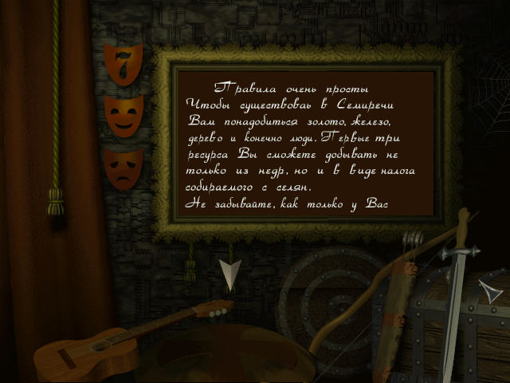

# Экран «От авторов» и оставшиеся фоны (C8)

Подтверждён экран SCREENS №9, его палитра, шесть виджетов и десять страниц
правил. Подготовлены `assets/imported/credits/` и отдельный конвертер
`tools/credits_source.py`. Занятые Claude файлы интерфейса не менялись.
**C8 ещё в работе:** реальные состояния с фонами №8 и №13 не сняты.

## Таблица экранов

| SCREENS | Размер | Назначение | Палитра / доказательство | Статус |
|---|---|---|---|---|
| 8 | 640×480 | «Ваш ход» и имя игрока | `18930`/`19BF6`, строка LE:3 B8BB; локальной смены палитры нет, кандидат COLOR1 | без снимка, не выгружается как подтверждённый экран |
| 9 | 640×480 | «От авторов»: маски, рамка с инструментами | **FROM_AUT.PAL**, `1C4C9..1C4DE`; полный экран со спрайтами совпал с DOSBox, кроме отдельно исключённого курсора | подтверждено, background.png |
| 13 | 640×480 | победная заставка с прокруткой текста | **VICTORY.PAL по коду**: загрузка `18A08..18A1D`, указатель A083; `1CF11` рисует №13, `1CF2A/1CF35` применяют палитру | без снимка настоящего завершения, не выгружается как подтверждённый экран |

№8 рисуется при `[1EC6]=4`: `19BFF..19C67` временно ставит исходный
игровой шрифт, выводит «Ваш ход» (B8BB) и имя, затем ждёт через `19CD5`.
`9CDF` задаёт 1EC6=4 при переходе к следующему игроку. Здесь не доказано,
какая текущая палитра во всех допустимых внешних путях; кандидат COLOR1
не превращён в runtime-ресурс по внешнему сходству изображения.

№13 вызывается в `1CE9A..1CFEE`: читает сохранённый блок, вызывает
`1A0DD/1CCCD`, рисует фон, делает fade-in через `19518` к VICTORY.PAL.
`1CFEF..1D0F3` обслуживает строки таблицы LE:3 DDDC (по 24h байт).
Таблица прокрутки теперь извлечена в `data/original_victory_scroll.json` из
LE:3 `DDDC`: 22 записи по 24h байт, нулевая запись в `E0F4` завершает цикл.
Поля +0/+4 — текущие x/y, +8/+C — начальные x/y, +10 — указатель
на строку CP866 до FFh, +14..+20 — начально нулевые рабочие поля
растеризатора. В `1D006` начальные координаты копируются в текущие;
`1D029` рисует строки через `1B258`, сохраняя рабочие поля; `1D094`
каждые пять байтовых тиков уменьшает все y на 1. Последняя строка
содержит FFh сразу и оставлена пустой. Это данные оригинала, включая
пустые строки и большие интервалы, без ручной переписи/OCR.
Проверка полного растеризатора прокрутки и естественного условия победы
остаётся следующему срезу. Снимок рендера извлечённого PNG не выдаётся за снимок игры.

## Экран №9: режимы и расположение

Вход `1C4B5` обнуляет DDC6/DDC7, очищает ввод через `1C5AC`, выбирает
FROM_AUT.PAL из A07F, рисует фон №9 и обрабатывает группу **LE:3 DC9C**.
Реестр вызовов — [credits-call-graph.md](credits-call-graph.md).

Шесть записей по **31h=49** байт: type=0Bh, flags=09h, callback +6,
action +0Ah, scan code +0Eh, прямоугольник +14h..+20h, sprite base +24h,
текущий кадр +28h и четыре параметра состояний +2Ch..+2Fh.
Конвертер проверяет формат и сохраняет адреса/поля в манифесте.

| LE:3 | Прямоугольник x,y,w,h | MENU.SPR | Callback / действие |
|---|---|---|---|
| DC9C | 122,49,64,66 | 280..282 | 1C5D0 → 1C93E: видео FROM.SMK, режим DDC6=1 |
| DCCD | 123,115,64,66 | 283..285 | 1C5D0 → 1C9ED: запуск демонстрации; выставляет 4168=1, DDC7=1, A0A7/A0A9=0, закрывает авторский экран; внешняя ветвь 18810 |
| DCFE | 125,182,64,66 | 286..288 | 1C5D0 → 1CA3A: правила, DDC6=3, DDC8=0, DDCC=−1 |
| DD2F | 41,237,64,36 | 295..296 | 1C5D0 → 1C917: сброс вкладки и восстановление фона |
| DD60 | 215,318,45,52 | 289..291 | 1C802: предыдущая страница, Up / PageUp |
| DD91 | 270,318,45,52 | 292..294 | 1C6F7: следующая страница, Down / PageDown |

Последние два `sprite_base` в исходных записях соответственно **292 и 289**;
callbacks переустанавливают кадры, поэтому их нельзя механически принять
за активный кадр каждого виджета. Неактивные кадры — 289 и 292, нормальные
активные — 290/293, нажатые — 291/294. Край страницы 0/9 отключает стрелку.

`1C56F..1C5AB`: Escape или правая кнопка мыши сперва закрывает текущую
вкладку (`1CB69`), а следующий такой ввод закрывает экран авторов (DDC7=1).
При выходе `1C53D..1C56E` возвращает MENU1.PAL и SCREENS №4.

Видео: режим 1 открывает уже перенесённый FROM в **(224,90,320,180)**,
обновляет по разности байтового таймера >=5 и по завершении сбрасывает
виджет/режим. Подробности потока — [video.md](video.md); повторного
исследования Smacker и повторного экспорта видео этот срез не делает.

Средняя маска запускает **игровую демонстрацию**, а не ещё одну текстовую
вкладку. Независимое подтверждение флага 4168: `307F..30E7` при ненулевом
значении копирует имя **`demo    `** из LE:2 1EF8, ставит идентификатор 21h,
читает эпизод и начинает демонстрационный путь. Файл воспроизведения
назван `demo1   .dem` в LE:3 416A. Полный декодер DEM этим не восстановлен.

## Правила — изображения MENU, не таблица текстовых строк

В режиме 3 `1CB11..1CB68` сравнивает текущую страницу DDC8 с DDCC и при
изменении восстанавливает (224,90,320,180), затем рисует **MENU[297+page]**.
Всего **10 страниц**, 297..306. Все они уже содержат рукописный текст.
Стрелки после пяти тиков нажатия меняют DDC8 и сбрасывают виджет; удержание
клавиши может перейти сразу через несколько страниц, как в оригинале.

`186C6..186F6` находит MENU-запись через `1E133` и вызывает **19465**.
Здесь RLE-рисовальщик держит ширину в dword EAX/EBX, поэтому 320 пикселей
допустимы. Это отличается от 1E098 с байтовой шириной. Содержимое записей
297..306 — не RAW: 57 600 пикселей плюс RLE-заголовки, 58 140 байт на запись.

Кандидат LE:3 **CFD0** из формулировки C8 — конец уже перенесённой
вступительной истории **CA0E**, записи по 24h: строки x=50, y=1320/1340/1360
«Когда золото в долинах заканчивалось…», «дальше от своих поселений…»,
«Здесь в глуши лесов люди обнаружили…». Это не титры авторского экрана и
не источник текста его десяти страниц. `interface_source.exe_texts` уже
извлекает все 44 строки; занятый импортёр не менялся.

## Сверка



- `original-credits-empty.png`: SCREENS №9 + кадры виджетов
  **280,283,286,295,289,292** воспроизводят весь кадр 640×480; исключён
  только известный прямоугольник анимированного курсора **(600,350,32,32)**.
  Подтверждены остальные **306 176 RGB-пикселей**.
- `original-credits-rules-00/03/09.png`: целиком сравниваются все **57 600
  пикселей** каждой страницы в (224,90). Палитра FROM_AUT совпала точно.
- `verify_credits.py` исполняет настоящую **19465** для всех 27 MENU-записей
  280..306. Два фона A5/5A восстанавливают прозрачные прогоны; каждый RGBA
  совпал с конвертером. Заглушён только dirty-helper 3EEA, остальные выходы
  из указанной процедуры запрещены. Фикстура хранит размеры/хеши, не код.
- C# `original-credits` повторяет хеши по подготовленным PNG без ISO;
  Python сравнивает также реальные снимки, включая прозрачное наложение
  шести виджетов. Никакой ретуши исходных снимков нет.

```sh
python tools/credits_source.py --game /path/to/Program_Executable_Files
python tools/verify_credits.py --game /path/to/Program_Executable_Files \
  --fixture /tmp/credits.json
godot --headless --path . tests/TestRunner.tscn -- original-credits
```

Для завершения C8: получить оригинальный «Ваш ход» и победный экран №13,
сверить их палитры, затем дополнить конвертер. Манифест явно оставляет
`screenshot_verified=false`; эти два PNG не назначены игровому runtime.
Полные режимы вкладок и воспроизведение авторского экрана подключает Claude.
