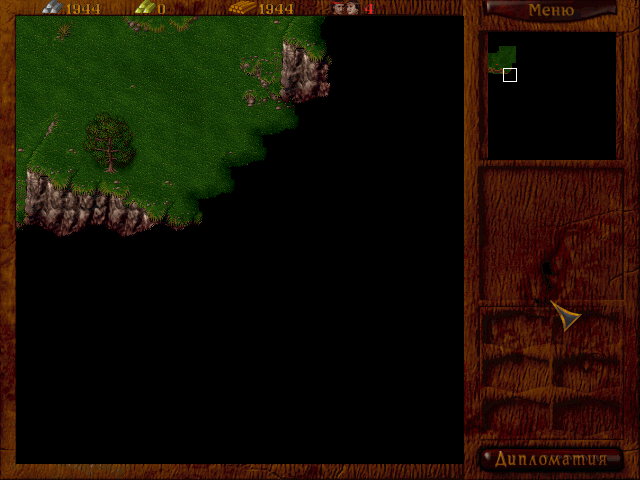

# Туман войны (C6)

Перенос вынесен в `scripts/OriginalVisibilityRules.cs` и
`scripts/OriginalFogGraphics.cs`: открытие клеток, углы маски, пиксели
сглаженного тумана и миникарты. Ресурсы подготовлены в Git и не требуют ISO.
Подключение к `SkirmishMain` оставлено Claude, как требует очередь.
Графы: [открытие](visibility-reveal-call-graph.md),
[отрисовка](visibility-render-call-graph.md). Графы ИИ не перезаписывались.

## Постоянная разведка

`[18DA]` — указатель на **один байт на клетку**, row-major, размер
`[18DE] × [18E2]`. Это обратная маска: **1 = не разведано**. Инициализация
LE:1 `24D9..24F5` заполняет её FF. После ухода юнита открытые клетки не
закрываются: `813E..81D9` только сбрасывает биты. Не нужно восстанавливать
круг видимости вокруг всех юнитов каждый кадр и заново затемнять остальное.

`813E` вызывает уже перенесённый `6885` для выбора DAT по OBE[0]/[0E].
`8143` читает **DAT[47h]**, `8146..814E` прибавляет единицу при
**OBE[16h] >= 40** (без знака, включая 128..255). Флаг здания DAT.u32[40]
и footprint DAT[3]/[4] здесь не проверяются. В отличие от поиска цели,
разведка — квадрат `(2r+1) × (2r+1)` вокруг `u32 OBE[4]/[8] >> 5`.
`8156..8192` обрезает его по границам карты. Для исходных DAT радиусы
0, 1, 3, 5, 6, 8, 10; байтовые переполнения в искусственно изменённых
DAT не интерпретируются как допустимая геометрия C#.

`8198..81D8` применяет `ROL32(FFFFFFFEh, owner) & FFh` к каждому байту
прямоугольника. Для owner 0..7 это удаляет ровно один бит. Участники
8..31 не имеют представимого бита в этой карте; это ограничение оригинала,
а не повод молча расширять маску в точном переносе. ROL/SHL счётчики
в x86 берутся по модулю 32; в тестах есть owner 32 и 255.

Найденные вызовы открытия:

- `72B3`: неподвижный юнит, если OBE[2C] = 0;
- `81D9`: общая регистрация объекта перед записью занятости;
- `12A7B`: движение, если `OBE[2E] & 3 == 0` (каждое четвёртое обновление).

Сценарная ветвь `121C0..121E1`, после проверки `124D8`, открывает всю карту.
В ней **SHL8(FEh, owner)**, а не ROL: очищаются также младшие биты до owner.
Это сохранено в `RevealAllFromScenario`, но диспетчер сценарных условий
и вызов `124D8` в этот модуль не входят. Странность не исправлена скрытно.

## OBE[20h] — отдельная маска

ИИ `2055C`, обычный поиск врага `D895` и выбор объекта `67D3` читают
OBE[20h], но `813E` её **не пишет**. Создание объекта `A855` задаёт FF;
строительство `DCDC..DCE3` ставит только бит владельца, `DD15` возвращает
FF. Есть отдельная запись FF в `8815`. Этот модуль не вычисляет OBE[20]
по разведке и не объявляет её временной видимостью из круга обзора.
Полные жизненные циклы этих записей остаются вне границы C6.

## Углы тумана на большом экране

`9F38..A10B` обрабатывает видимые 14×14 клеток, по 32×32 пикселя.
Сначала копирует окрестность 16×16 в scratch `1F45`, дополняя край карты
FF. Открытая центральная клетка не затемняется. Для неоткрытой клетки
каждый угол остаётся закрытым, только если закрыты все три соседа у него:

| Бит | Соседи |
|---|---|
| 1 | N, NE, E |
| 2 | NW, N, W |
| 4 | W, SW, S |
| 8 | E, S, SE |

Маска 0 не меняет пиксели; 15 заливает 32×32 индексом 0. Остальные
выбирают `WORK.SPR[164 + 2*mask + ((worldX+worldY)&1)]`, то есть **166..193**.
Это RAW-таблицы 32×32 со значениями 0..8, не RLE-спрайты. Оригинал
подменяет индекс пикселя через `[19F6] + 700h + 256*weight + oldIndex`.
`6B78..6BA3` загружает 8192 байта **FADE_COL.TAB** в `[19F6]` (имя
LE:2 `220h`). `tools/visibility_source.py` преобразует 28 таблиц в атлас
`fog_weights.png` (L8, исходные значения 0..8), девять строк FADE_COL
в `shade_indices.png` (256×9, индексы), COLOR1 с квантованием VGA DAC
в `palette.png`. Это новые ресурсы `assets/imported/visibility/`, занятый
интерфейсный конвертер и его каталог не меняются.

`OriginalFogGraphics.ShadeViewport` применяет эти данные к индексному
framebuffer 14×14 клеток, по умолчанию с экранного (16,16).
`ShadeTile` сохраняет исходную табличную замену цветов: обычное смешивание
чёрного RGB с альфой не объявляется эквивалентом. При подключении к RGB-
рендереру Claude потребуется сохранять исходные индексы земли/объектов
или ввести соответствующий lookup-шейдер; этот срез не изменяет renderer
схватки. `ToRgb` преобразует результат для Godot без исходных файлов игры.

## Миникарта

`A1D1..A320` (внешние флаги перерисовки `1C4E`, `1C60`) рисует один
пиксель на клетку. Если бит разведки стоит, цвет **0**, независимо от
занятости. Иначе:

1. Берётся объект из плоскости 2; если его нет — плоскость 1. Плоскость 0
   не читается. OBE[20] при этом не проверяется.
2. Если владелец отличается от глобального `[1971]`, цвет берётся из
   `[1C50 + (owner & 15)]`. Иначе выводится цвет земли, как для пустой клетки.
3. Цвет земли: `u16 mapCell[0]` → таблица по `[18FA]`.

Восемь цветов `1C50..1C57` соседствуют с координатами миникарты
`1C58/1C5C`; индексы 8..15 читают байты этих координат. Oracle сохраняет
это наложение. C# принимает 16-байтовое окно цветов явно, без назначения
смысла неизвестным владельцам. Затем рисуется рамка камеры **14×14,
индекс 1** (`A2C8..A2FB`). Перенесены сами пиксели; внешнее расписание
перерисовки и адрес DOS-framebuffer не переносятся.

## Проверка

`tools/verify_visibility.py` исполняет оригинальный код под Unicorn.
Внешний `6885` исполняется настоящий; `3EEA` (dirty-учёт) заменён RET,
с сохранением регистров. Остальные выходы за границы немедленно отклоняются.
Фикстура `tests/fixtures/visibility.json` содержит только параметры и SHA-256:

- 4032 открытия: четыре размера карты, шесть положений у краёв/в центре,
  четыре радиуса, шесть значений опыта, семь владельцев. Сравнивается каждый
  байт карты, проверяются защитные полосы вокруг неё;
- 256 значений владельца сценарного раскрытия;
- 16 384 комбинации углов, центра, владельца и посторонних битов;
- 28 выборов номера WORK-таблицы;
- 60 **полных framebuffer 640×480** миникарты, включая неизменённый фон,
  рамку камеры, пустые/занятые клетки, приоритет плоскостей и особого владельца.

C# повторяет входы и сравнивает хеши; отдельные проверки закрепляют
необратимость открытия и порог опыта. Режим `original-visibility` включён
также в `simulation`.

`tools/verify_fog_raster.py` дополнительно исполняет **всю 9F38..A10B** с
настоящей `1E133` и исходными WORK/FADE_COL. 135 полных framebuffer
640×480 (карты 16×16, 31×23, 160×160, все края и центр, три владельца,
полностью закрытая/частично открытая/шумовая разведка) совпадают с C#
по каждому индексу и каждому RGB-байту. Заглушек во время этого прохода
нет. Scratch/dirty-cache 33C не становится частью нового хранилища состояния.
Режим `original-fog` включён в `simulation`; графический `fog` дополнительно
сверяет снятый с Godot кадр по RGB-SHA и сохраняет `build/fog-preview.png`.

### Снимок настоящей игры



`docs/reference/fog-edge.json` фиксирует камеру **(15,36)** и экранный
прямоугольник **(16,16,448,448)**. На миникарте рамка 503,68..516,81:
при её начале 488,32 это те же координаты камеры. После загрузки Олега
в DOSBox выполнены «Старт» и щелчок миникарты (510,75); курсор убран
в правую панель. EXE не изменялся.

`tools/match_fog_reference.py` для каждой клетки берёт **исходный тайл
MAP_1.MAP/MAPSEG01.SEG** и перебирает 16 масок из восстановленного вывода.
Для всех **196 тайлов** нашлась ровно одна маска с полным совпадением
32×32 RGB, включая **16 частично затенённых** тайлов; исключённых пикселей
и ручных ретушей нет. Индексная подложка до затемнения сохранена отдельно
в `original-fog-underlay.png`; Python-тест повторяет сравнение всей области
448×448 по подготовленным PNG, без исходных файлов игры.

Граница доказательства: маски здесь **подобраны по снимку**. Этот тест
подтверждает форму/цвета/размеры тумана и палитру, но не объявляет полностью
восстановленной историю перемещений и разведки этой сохранённой игры.
Правило открытия проверяется независимо предыдущей Unicorn-фикстурой.

```sh
PYTHONPATH=/path/to/python-libraries python tools/verify_visibility.py \
  --game /path/to/Program_Executable_Files --fixture /tmp/visibility.json
godot --headless --path . tests/TestRunner.tscn -- original-visibility
python tools/verify_fog_raster.py --game /path/to/Program_Executable_Files \
  --fixture /tmp/fog-raster.json
godot --headless --path . tests/TestRunner.tscn -- original-fog
godot --path . tests/TestRunner.tscn -- fog
python tools/match_fog_reference.py --game /path/to/Program_Executable_Files \
  --screenshot docs/reference/original-fog-edge.png --camera 15 36 \
  --output /tmp/fog-edge.json --underlay /tmp/fog-underlay.png
```
