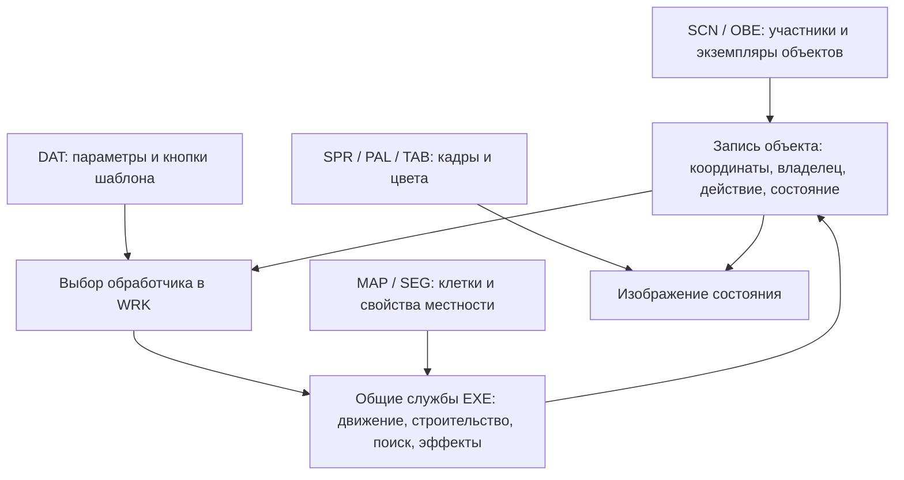
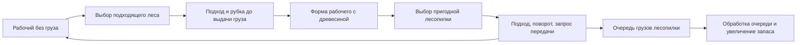

# Как восстановить устройство игры целыми системами

Цель этого документа — объяснить поведение игры и порядок переноса без необходимости читать каждый числовой эталон. Это рабочая спецификация: установленные правила ссылаются на код, гипотезы и воспоминания игрока имеют отдельный статус. Исходных текстов разработчика в имеющемся образе нет; исследуются исполняемый код и данные.

## Основная архитектура



Стрелки показывают зависимости, а не восстановленный порядок глобального такта. Для него ещё нужно установить частоту и очередность обновлений.

Вместо поиска 123 независимых реализаций следует идти по цепочке **экземпляр объекта → шаблон DAT → вход WRK → общая служба EXE**. Загрузчик и вызов этой цепочки подтверждены инструкциями: [executable-analysis.md](executable-analysis.md). AH=0 используется в проверенном пути создания, AH=1 — в общем цикле обновления. Остальные значения AH нужно называть по проверенному вызывающему коду каждого обработчика: универсальная схема всех событий ещё не установлена.

[Индекс всех входов](logic-handlers.md) содержит **123 шаблона и 111 пар «WRK + смещение»**. Это удобный список мест исследования, а не 111 полностью разобранных функций. Внутри WRK остаются общие хвосты, подпрограммы и таблицы переходов. 107 известных присваиваний FS указывают на общие службы EXE; их адреса сохранены в [code-analysis.json](code-analysis.json), но смысл всех служб ещё не доказан.

Примеры из ARMY__02:

- Ополченец [0] и рыцарь [18] входят в WRK+0000; лучник [1] и поджигатель [17] — в WRK+007F. Различия параметров и внутренних ветвей всё равно нужно читать.
- Три шаблона «Рабочий» [8/10/11] имеют разные входы 09ED/07F5/08FE. Для проверенного древесного цикла [10] — пустая форма, [11] — груз древесины; назначение [8] нельзя выводить только из одинакового имени.
- Замок [2] — 00FE, лесопилка [4] — 0354, шахта [6] — 0524, ферма [9] — 0756. Это ближайшие точки входа для связанного хозяйства.
- Предводитель [20] — 10F1, дракон ARMY__03[27] — другой WRK и другой вход. Сюжетные правила героя нельзя автоматически переносить на обычного воина.

## Что уже известно о поведении

| Система | Установлено по коду | Чего не хватает для полной копии |
| --- | --- | --- |
| Приказы | Команды в DAT; постановка прямого действия и переход после завершения текущего | Полный групповой диспетчер, все режимы интерфейса и доступность команд |
| Движение | Выбор направления, поворот, свойства местности, области занятости, локальный обход и хранение пути | Полный автомат контактов, бюджет поисков и исходная координация дальнего приказа |
| Древесина | Критерий леса, выбор участка, удары, груз, выбор лесопилки, подход, передача и зачисление | Полный внешний автомат рабочего, исходная частота обновлений и все формы груза |
| Стройка и ремонт | Первичный четырёхслотовый платёж, базовая проверка места, переходы действия, платный шаг состояния и повреждение | Полный жизненный цикл здания, все ограничения и доступная игроку команда ремонта |
| Запасы и цены | Четыре материала/население из SCN, цены найма и стройки из DAT; названия прослежены через статистику | Добыча металла/золота, производство по времени и возврат при отмене; [доказательства](scenario-resources.md) |
| Фермы и содержание | Поддержка, нагрузка, предел и числовой прирост установлены по D453/D40C; фермы и найм подключены к схватке | Полный WRK фермы, производственная очередь, дань и бунт |
| Шахты | Точка входа и ветвление по событиям найдены | Добыча, формы груза, получатель и назначение ресурсных слотов |
| Бой | Есть точки входа воинов, общий код и исходные параметры | Формулы попадания/урона/защиты, снаряды, выбор цели и полный цикл смерти |
| Мир и кампания | Прочитаны 12 сценариев; найдены специальные объекты, выходы, герой и дракон | Соответствие сценариев миру 3×3, переходы, состояние покинутых карт и условия завершения |

Основания: [приказы](building-command-lifecycle.md), [платёж и размещение](construction-payment-placement.md), [состояние здания](building-condition-kernel.md), [лес](native-forestry.md), [анимация рабочего](worker-strike-animation.md), [доставка](worker-delivery.md), [подход](worker-approach.md), [поиск пути](native-route-search.md).

В текущей схватке здоровье, бой, частота тактов, цены, начальные запасы и дальние подсказки маршрута остаются экспериментальными: [границы игрового режима](playable-skirmish.md), [хозяйство](wood-economy.md). Воспоминания о данях, бунте и карте мира сохранены в [player-gameplay-notes.md](player-gameplay-notes.md); они задают вопросы исследования, но не заменяют доказательство из кода.

## Пример спецификации: полный древесный цикл

На уровне игровых действий уже получается такая цепочка:



Это поведенческая схема, а не доказательство единого исходного диспетчера целиком. Подтверждённые блоки уже соединены адаптером схватки. При временно занятом входе груз сохраняется; при потере получателя выбирается другой. Груз не должен дважды увеличивать запас. Проверенный слот древесины в этой цепочке — +1C записи участника. Слот +24 теперь установлен как свободные люди через [расчёт населения](population-farms.md); смысл первых и третьих запасов ещё требует отдельного подтверждения.

Для нового ресурса нужно восстановить именно такую связанную цепочку, включая прекращение работы и неудачные случаи, а не только операцию прибавления числа.

## Начальная зацепка по фермам

Начальные **статические наблюдения**, ещё не проверенные исполнением полного обработчика: ARMY__02.WRK+0756 выбирает ветвь AH=1 по 0761. При установленном бите 80 в OBE[14] участок 0767–077A очищает этот бит, вызывает FS:001D и FS:006D, затем прибавляет DAT.u32[78] к записи участника +2C. Ветвь 079D–07BA обращается к тому же счётчику: при предыдущем состоянии OBE[1A] выше DAT[46] вычитает DAT.u32[78], ограничивая результат нулём при заимствовании.

Слоты FS:001D → EXE+81D9, FS:006D → EXE+6877, FS:0041 → EXE+C88C взяты из существующего профиля загрузчика. Роль +2C как вклада поддержки ферм теперь подтверждена [общим пересчётом D453](population-farms.md). Там же разобраны нагрузка +28, предел +30 и прирост свободных людей +24. Полные переходные события WRK, дань и бунт остаются отдельными задачами.

Вход шахты WRK+0524 различает AH=0/1/2/4/5. Это только установленное ветвление; смысл событий 2/4/5 и весь цикл добычи ещё предстоит восстановить. Полный псевдокод фермы и шахты здесь не заявляется готовым.

## Более короткий путь к игровой копии

1. **Одна система за этап.** Выписать входные команды, состояния объектов, выходы, расходы и причины отказа. Таблицы выше и индекс дают точки входа.
2. **Декомпиляция по графу вызовов.** В Ghidra или REA определить LE/WRK-адресацию и соглашения вызова, пометить DAT/OBE/участника и службы FS. Общие функции именовать один раз. Автоматический псевдокод проверять на встроенных таблицах и косвенных вызовах; он не восстанавливает авторские имена и комментарии.
3. **Читаемая спецификация до реализации.** Для каждого действия записать: «при таком состоянии и команде происходит это; при таком препятствии — другое». Отмечать доказанные правила, гипотезы и временную реализацию.
4. **Перенос связанного сценария на C#.** Проверять пользовательский результат: например, ферма влияет на восстановленный показатель, затем обычная команда найма использует его и корректно отказывает при нехватке.
5. **Сравнения там, где важны границы.** Использовать исходное исполнение для формул, переключений и неоднозначных условий. Число перебранных комбинаций само по себе не является мерой готовности игры.

Связка **ферма → счётчики участника → прирост → найм** уже доступна: [границы переноса](population-farms.md). Следующие содержательные этапы — исходные запасы/цены и очередь производства, затем полное содержание и бунт. После него — **шахта → доставка → расход**, затем исходный бой и переходы мира. Обработчик столкновений остаётся задачей движения; его следует доводить по мере необходимости для этих игровых сценариев. Полный реестр этапов сохраняется в [port-plan.md](port-plan.md).

Декомпилятор ускорит чтение функций. Для восстановления намерений программиста всё равно нужны контекст вызовов и связанные сценарии: по одному имени «Ферма» или одному полю записи нельзя надёжно вывести правила населения и бунта.

Индекс воспроизводится без образа и EXE:

```sh
python tools/catalog_game_logic.py
python tools/catalog_game_logic.py --check
```

Это вспомогательное исследовательское средство; запуск игры из готовых ресурсов по-прежнему не требует Python.

Для адресного учёта всех областей используется [база ассемблера и статусов](assembly-database.md); необработанные диапазоны и спорные границы сохраняются явно.
