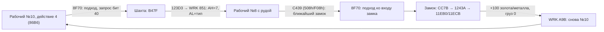

# Добыча руды: шахта → рабочий → замок

Цикл добычи восстановлен по исходным инструкциям и подключён к схватке. Рабочий по приказу (ПКМ по своей шахте) идёт ко входу шахты, получает мешок, несёт его в замок, где запас владельца увеличивается на 100, и возвращается за следующим. Шахта при каждом мешке списывает 100 из запаса; примерно каждые 20 мешков с карты исчезает одна рудная отметка и тайл меняется на обычную поверхность.

**Код руды 1 — золото, 2 — металл.** Это теперь установлено кодом: обработчик 1 (LE:1 `11EB0`) прибавляет 100 к запасу участника +20 (золото) и статистике +1A08, обработчик 2 (`11ECB`) — к +18 (металл) и +1A0C. Связь полей с названиями описана в [запасах](scenario-resources.md).

Адреса — LE:1 (кодовый объект NORWIND.EXE) и смещения в ARMY__02.WRK. Таблица видов груза лежит в LE:3 `+4191`, шаг 25 байт; указатель обработчика — в `+4195`, что подтверждено записью релокации операнда `12464 → LE:3:4195`.

## Цепочка



### Шахта, B47F..B502

Вызывается из таблицы действий шахты (WRK `67D`, после `C88C`) при каждом её обновлении.

- Запас (dword +24) равен 0: уменьшается байт +15; при достижении 0 уменьшается состояние +19. Это медленный износ пустой шахты; её разрушение отдельным кодом не переносилось.
- Нет запроса (бит 40 в +17): раз в 16 глобальных тактов (`[19EA] & F`) рабочему во входе ставится бит 20 (толчок посторонним).
- Запрос есть: `C4CD` находит объект в фиксированной клетке входа (DAT шахты +53/+54 = 0,−48). Нет объекта — запрос снимается. Чужой владелец — выход **без** снятия запроса шахты. Иначе снимается бит 40 посетителя и вызывается `123D3` с типом шахты (+23). Отказ — запрос снимается. Успех — `запас = max(запас − 100, 0)`; если изменилась величина `запас >> 11`, вызывается `B502`.
- **B502**: снова считает руду этого типа в области `B3F7` радиуса DAT[78] (у шахты 1, т.е. 3×3), берёт случайный индекс `(rnd × N) >> 8`, очищает тип в найденной клетке и через `CE9D` выбирает случайный тайл того же набора углов с классом поверхности 0. RNG — общая таблица `9E41`.

Глобальный указатель `[1C49]` — DAT обновляемого объекта (диспетчер LE:1 `430E..4343`), поэтому радиус берётся из DAT шахты.

### Выдача мешка, 123D3 → WRK 7F5/851

Живой (знаковый +19 > 0) рабочий с DAT-флагом 20000 получает AH=7. Пустой рабочий №10 принимает только при пустом грузе: код 3 → №11 (древесина, перенесено ранее), коды 1/2 → №8 через инициализацию `9ED` AH=0 (+20=FF, +0F=13, кадр по направлению, случайный +2E). В отличие от древесины, +14 не меняется — действие 4 сохраняется. Прочие коды обнуляют груз и отказывают.

### Рабочий с рудой, 86B6..877F

Фаза в +15, цель в +1C, запомненная шахта в +32, таймер/фаза подхода в +30.

| Фаза | Поведение |
| --- | --- |
| 0 | +32 ← +1C. С грузом — поиск замка, без груза — фаза 1 к шахте |
| 1 | `8F70` к шахте. Успех с грузом → поиск замка; неудача → фаза 3 |
| 2 | `8F70` к замку. Успех без груза → снова фаза 1 к шахте (в том же такте); неудача → фаза 3 |
| 3 | Отход `8B0F`, затем ожидание: +30 растёт до переполнения (255 тактов), потом повтор по наличию груза |

Перед фазами 1–3 запомненная шахта проверяется: чужая или с +19 ≤ 0 забывается. Получатель ищется `C439` с `EAX=508h, EBX=F08h` — у замка `DAT.flags = 200518h`. Проверки входа (AH=5): шахта — как у лесопилки (`flags & 1000` либо класс 300h); замок — тот же владелец и флаг 20000.

### Замок, CC7B

Вызывается в каждом обновлении замка до диспетчера действий. При запросе (бит 40) посетитель во входе (DAT +53/+54 = 48,64) с флагом 20000 сдаёт груз через `1243A`: код 0 — ничего, 1/2 — обработчики выше. Владелец посетителя **не проверяется**: зачисление идёт владельцу замка. Не-рабочий во входе не снимает запрос. Раз в 16 тактов посетителю ставится бит 20.

Пустой рабочий №8 (`WRK A37..A43 → A9B`) превращается в №10 с инициализацией (+0F=3F) без сброса +14/+15, поэтому продолжает цикл.

## Подключение к схватке

`SkirmishMining.cs`: шахта и замок игрока исполняют `B47F` и `CC7B` каждый такт после строительства; рабочий с приказом исполняет `86B6` с настоящим `8F70`, `C439` и проверками AH=5. Мостом остаются:

- маршрут (AStarGrid2D) и **отход 8B0F** — шаг в первую свободную соседнюю клетку; исходный `8B0F/A38A` не перенесён;
- глобальный счётчик `[19EA]` — младший байт счётчика обновлений объектов; [частота](game-timing.md) исходная — 18,2/с;
- посетитель замка с иным грузом (не 0/1/2) пропускается: такие коды идут в слоты предметов `+CD`, не перенесены;
- износ пустой шахты считается, но её уничтожение не подключено; ветка сброса груза при гибели рабочего (`WRK AB3..`, объект 26h) не перенесена.

## Проверки

`tools/verify_ore_extraction.py` исполняет исходный код под Unicorn с ограничением допустимых участков; эталон `tests/fixtures/ore-extraction.json` содержит параметры и SHA-256 результатов.

| Область | Случаев |
| --- | ---: |
| Выдача: все 256 кодов, прежний груз, состояние, флаги DAT, направления, RNG | 92 160 |
| Полный B47F с C4CD, 123D3, B502/B3F7, CE9D на первой карте: запасы на границах 100/2048, запрос, такт, посетители, износ | 51 840 |
| Замок CC7B → 1243A: флаги, шаблоны 0/8/10, грузы 0–2, владельцы, такт, переполнение u32 | 2 916 |
| Контроллер 86B6 с записью вызовов 8F70/C439/8B0F | 4 608 |
| Проверки AH=5 шахты и замка | 28 |
| Возврат пустого №8 → №10 | 1 024 |
| **Всего** | **152 576** |

`8F70`, `C439`, `C4CD/C591` проверены ранее ([подход](worker-approach.md), [доставка](worker-delivery.md)); в контроллере они заменены заглушками, вызовы которых сравниваются. Сквозной режим `mine` строит шахту на руде, нанимает рабочего, проверяет списание 100, зачисление ровно одного мешка нужного ресурса и следующий заход.

```sh
godot --headless --path . tests/TestRunner.tscn -- original-ore
godot --headless --path . tests/TestRunner.tscn -- mine
python tools/verify_ore_extraction.py --game /путь/к/игре --fixture /tmp/ore-extraction.json
```
